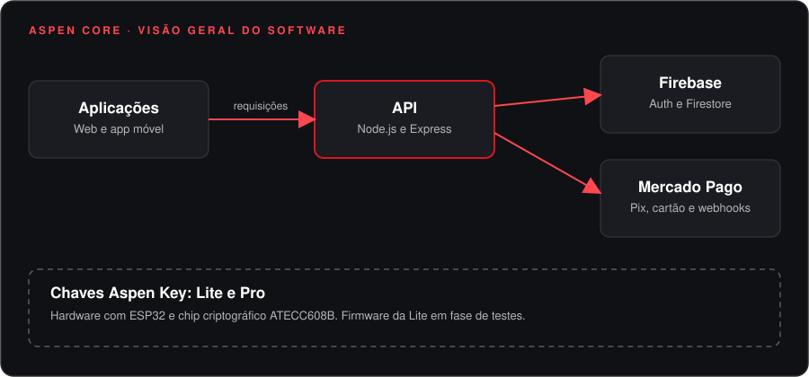

 

Olá, eu sou o Igor.

Desenvolvo backend e bancos de dados com atenção especial à segurança. No **ASPEN CORE**, plataforma de segurança digital com chaves de acesso físicas, trabalho em equipe cuidando da API, da autenticação, dos pagamentos e da integração com o hardware.

## Projetos em destaque

<table>
  <tr>
    <td width="42%" valign="top">
      
    </td>
    <td valign="top">
      <b>ASPEN CORE</b> 
      Plataforma de segurança digital que reduz a dependência de senhas, com chaves de acesso físicas (Lite e Pro). Inclui loja com planos e combos, painel administrativo, mapa de localização das chaves, login com Google, 2FA por link mágico e adequação à LGPD. Pagamentos com Mercado Pago (Pix e cartão), com avisos e controle de inadimplência.
        
      Node.js · Express · Firebase · JavaScript · Mercado Pago · ESP32 · ATECC608B
       
      Em desenvolvimento · repositório privado
    </td>
  </tr>
  <tr>
    <td width="42%" valign="top">
      <b><a href="https://github.com/igor-oliveira-dev/IGECH-TECH">IGECH TECH</a></b>
    </td>
    <td valign="top">
      Aplicação web com integração a banco de dados, desenvolvida durante o curso técnico.
        
      JavaScript · MySQL · HTML · CSS
       
      <a href="https://github.com/igor-oliveira-dev/IGECH-TECH">Código</a>
    </td>
  </tr>
</table>

Para conversar, me chame no [LinkedIn](https://linkedin.com/in/igoroliveira-dev) ou por [e-mail](mailto:igor.silv802@gmail.com).

## Em que estou trabalhando

<b>ASPEN CORE</b>

 

O ASPEN CORE trabalha com dois modelos de chave: a **Lite**, com rastreio pelo celular, e a **Pro**, com hardware dedicado. Atuo no software (API, banco de dados, pagamentos, autenticação e testes) e na integração com o hardware. O firmware da chave Lite, baseado em ESP32 com chip ATECC608B, está em fase de testes.

## Pilha

## O que me interessa

Segurança da informação, autenticação sem senha, backend e integração entre software e hardware.

## Formação e certificações

| | Instituição | Ano |
|:--|:--|:--:|
| Técnico em Desenvolvimento de Sistemas | ETEC de Itaquaquecetuba | Conclusão em 12/2026 |
| Java Fundamentals | SENAI / Oracle | 2025 |
| BluePex Essentials (Redes) | BluePex Cybersecurity | 2026 |
| BluePex Cybersecurity Framework | BluePex Cybersecurity | 2026 |
